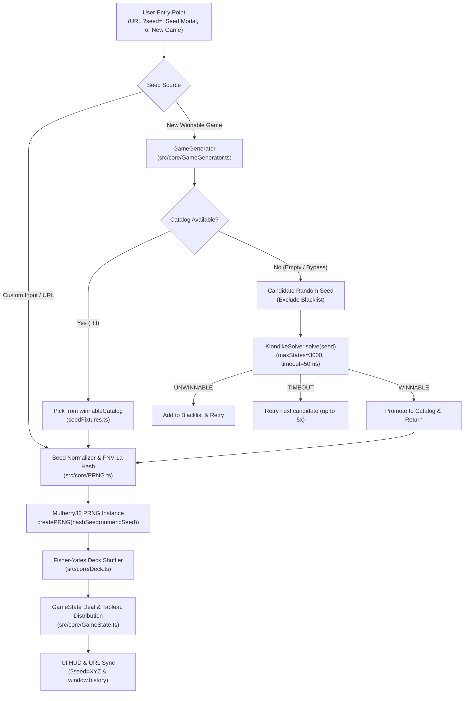
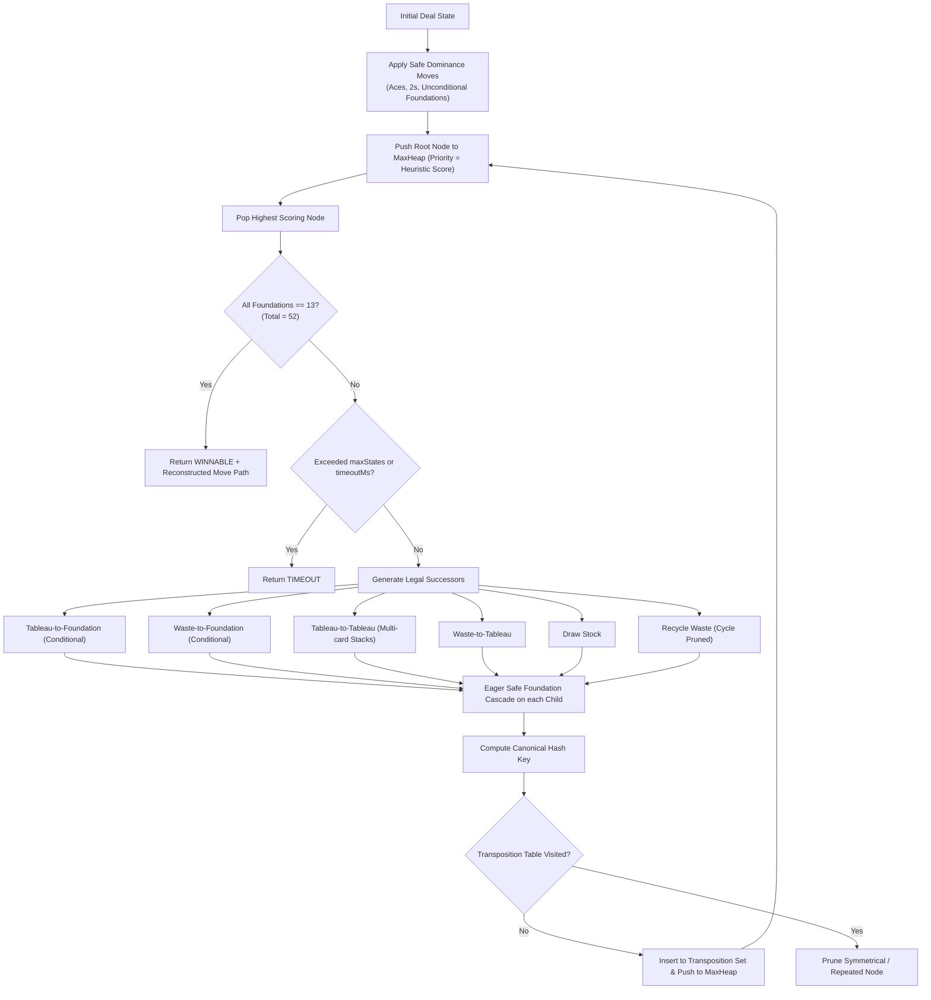

# Seeded Random Game Generation & Winnable Solitaire Architecture

**Target Modules:** `src/core/PRNG.ts`, `src/core/Deck.ts`, `src/core/GameState.ts`, `src/core/solver/KlondikeSolver.ts`, `src/core/GameGenerator.ts`, `src/core/data/seedFixtures.ts`, `scripts/find_unwinnable_seeds.ts`, `src/main.ts`, `src/ui/HUD.ts`

---

## 1. Executive Summary & Problem Formulation

In standard Klondike Solitaire (Draw-1 or Draw-3), cards are dealt randomly across seven tableau columns and a draw stock. Empirical studies and mathematical analysis indicate that **only ~79% to 82% of all random Klondike deals are theoretically solvable**, even under full-information "Thoughtful Solitaire" conditions where all hidden cards are known. In standard play with imperfect information, human win rates drop drastically to 10%–30%, and players regularly encounter hands where zero legal winning trajectories exist.

This module delivers a deterministic, high-performance architecture that achieves four core objectives:
1. **Deterministic Reproducibility**: Any game can be fully reproduced from an unsigned 32-bit seed or alphanumeric seed string across any browser, platform, or session.
2. **Instant Winnable Game Guarantee**: Players requesting a "Winnable Game" receive a guaranteed solvable deal in under 1 millisecond via an in-memory pre-verified catalog, with an on-the-fly heuristic solver fallback.
3. **Thoughtful Klondike A\* Solver**: A dedicated search engine capable of proving solvability, uncovering winning move sequences, and pruning dead-end states using dominance rules.
4. **Social Sharing & Persistence**: Two-way synchronization between URL query parameters (`?seed=...`), browser cookies, and the mobile HUD.

---

## 2. High-Level System Architecture

The following diagram illustrates the lifecycle of a game seed from player selection or generation down to deck shuffling and solver validation:



---

## 3. Deterministic PRNG & Seed Hashing

### 3.1 Mulberry32 Generator (`src/core/PRNG.ts`)

Standard `Math.random()` is non-deterministic and platform-dependent. The engine uses **Mulberry32**, an efficient 32-bit pseudo-random number generator that produces a uniform distribution over $[0, 1)$ with a period of $2^{32} \approx 4.29 \times 10^9$.

Key characteristics:
- **Bitwise Unsigned Shift (`>>> 0`)**: Enforces unsigned 32-bit integer arithmetic in JavaScript.
- **`Math.imul` Multiplication**: Guarantees C-like 32-bit integer multiplication semantics without precision loss.
- **Additive Constant `0x6D2B79F5`**: The Mulberry32 state advancement constant ensuring uniform bit mixing across iterations.

### 3.2 Seed Normalization & FNV-1a Hashing (`src/core/PRNG.ts`, `src/core/GameState.ts`)

To allow human-readable string seeds (e.g., `?seed=royal` or `?seed=42`), seed initialization follows a two-tier resolution:

1. **Seed Normalization**:
   - Numeric input or pure numeric strings (`"42"`) resolve directly to an unsigned 32-bit integer (`42 >>> 0`).
   - Alphanumeric strings (`"royal"`) are hashed into a 32-bit unsigned integer using the **FNV-1a** non-cryptographic algorithm (`hashSeed`).
   - The resulting unsigned integer is stored in `gameState.currentSeed` and displayed in the HUD badge.

2. **PRNG State Initialization**:
   - The Mulberry32 generator is seeded via `createPRNG(hashSeed(numericSeed))`.
   - Applying `hashSeed` on the normalized numeric seed ensures thorough bit diffusion across the full 32-bit space, preventing adjacent seed integers (e.g., seed 1 vs seed 2) from starting with identical low-order bit distributions.

### 3.3 Fisher-Yates Deck Shuffling (`src/core/Deck.ts`)

Deck generation constructs 52 standard playing cards (4 suits $\times$ 13 ranks) face down. Shuffling implements the in-place modern Fisher-Yates algorithm, parameterized with the injected PRNG function to guarantee deterministic ordering.

### 3.4 Tableau & Stock Distribution (`src/core/GameState.ts`)

Dealing pops cards from the shuffled deck in strict sequence:
1. **Tableau Columns 0 through 6**: Column $c \in [0, 6]$ receives $c + 1$ cards.
   - Cards $0$ to $c - 1$ are set `isFaceUp = false`.
   - Card $c$ (top of column) is set `isFaceUp = true`.
   - Total tableau cards: $\sum_{c=1}^7 c = 28$.
2. **Stock Pile**: The remaining 24 cards are popped face down into the draw stock.
3. **Waste & Foundations**: Initialized to empty arrays.

---

## 4. Thoughtful Klondike Solver (`src/core/solver/KlondikeSolver.ts`)

### 4.1 Theoretical Formulation

The solver treats the game as **Thoughtful Klondike Solitaire**: all face-down cards are known to the solver at search time. If a winning path exists in Thoughtful Solitaire, the deal is classified as `WINNABLE` because there is a valid trajectory from initial deal to completion without illegal moves.

### 4.2 Search Algorithm: Best-First A\* Search

The solver implements a priority-queue-driven Best-First search over the game state graph using a binary `MaxHeap`:



### 4.3 Heuristic Evaluation Function (`computeScore`)

Every state node is assigned a fitness score directing the search towards victory:

$$\text{Score} = (\text{foundationsTotal} \times 120) + (\text{faceUpCards} \times 12) + (\text{emptyColsWithKings} \times 8) - (\text{hiddenCards} \times 10)$$

- **Foundations Total ($w = 120$)**: Heavily prioritizes cards committed to foundations.
- **Face-Up Cards ($w = 12$)**: Rewards unearthing hidden cards in the tableau.
- **Empty Columns Occupied by Kings ($w = 8$)**: Rewards mobilizing Kings into opened columns to unlock buried card cascades.
- **Hidden Cards Penalty ($w = -10$)**: Penalizes unrevealed cards in tableau columns.

### 4.4 Canonical State Hashing & Transposition Table

Klondike exhibits massive symmetry and transposition: the same board position can be reached through different move orderings, and empty tableau columns or column permutations are strategically equivalent.

The solver computes a canonical string key via `getCanonicalKey(state)`:
```
<F_hearts>,<F_diamonds>,<F_clubs>,<F_spades> | <sorted_column_signatures> | <stock_ids> | <waste_ids> | <modified_flag>
```

#### Symmetry Breaking via Column Sorting
Tableau columns are formatted as `<hiddenCount>:<faceUpCardId1>,<faceUpCardId2>,...` and then **lexicographically sorted** (`colStrings.sort()`).
If Column 2 and Column 5 contain identical stacks or are both empty, swapping their positions produces an identical canonical key, immediately collapsing redundant search branches.

### 4.5 Dominance Rules & Pruning Strategies

To prevent combinatorial explosion, the solver executes four dominance rules:

#### 1. Safe Foundation Moves (Dominance Invariant)
Moving a card to a foundation is generally irreversible. However, a move is **dominant and safe** (cannot preclude an alternate winning solution) under the following conditions:
- **Aces and 2s** ($R = 1, 2$): Always safe, because no card can ever be legally built on an Ace in the tableau, and 2s only support Aces.
- **Rank $R \ge 3$**: Safe if and only if **both foundations of the opposite color** have reached at least rank $R - 1$.
  $$\text{Safe}(card) \iff F(\text{opp}_1) \ge R - 1 \land F(\text{opp}_2) \ge R - 1$$
- **Eager Cascading (`applySafeFoundationMoves`)**: The moment any state is generated, safe foundation moves are executed greedily in a loop until none remain. This substantially compresses the search tree.

#### 2. Redundant Empty Column Pruning
When moving a King into an empty tableau space, moving it to column $A$ vs column $B$ is identical. The solver restricts King placements solely to the **first available empty column** (`firstEmptyCol`).

#### 3. Column Base King Pruning
If a King is already at the base of a tableau column (`col[0]`) with no hidden cards beneath it, transferring that King and its stack to another empty column is pruned as a pointless lateral cycle.

#### 4. Stock Recycling Cycle Detection (`boardModifiedThisCycle`)
In Draw-1 / Draw-3 Solitaire, drawing through the entire stock and recycling waste without moving any card to the tableau or foundation returns the game to an identical state.
The solver tracks `state.boardModifiedThisCycle`:
- Initialized to `false` when waste is recycled back to stock.
- Set to `true` whenever any tableau or foundation card moves.
- If the stock empties and `boardModifiedThisCycle === false`, waste recycling is **forbidden and pruned**, terminating infinite cycling loops.

### 4.6 Performance & Budget Constraints

| Parameter | Default (Standard) | Fallback (Generator) | Offline CLI Scanner |
|---|---|---|---|
| `maxStates` | 10,000 | 3,000 | 5,000 |
| `timeoutMs` | 250 ms | 50 ms | 2,000 ms |
| State Bitmask Check | Every 8 states (`visitedStates & 7 === 0`) | Every 8 states | Every 8 states |

---

## 5. Winnable Game Generator & Catalog (`src/core/GameGenerator.ts`)

The `GameGenerator` coordinates seed delivery for the UI, ensuring instantaneous responsiveness while strictly avoiding known unwinnable deals:

1. **Level 1 — In-Memory Catalog Lookup**: When `bypassCatalog` is `false`, selects a random seed from `winnableCatalog` that is not present in `unwinnableBlacklist`. Latency is negligible ($< 0.1\text{ ms}$).
2. **Level 2 — Solver Fallback Verification**: If the catalog is empty, bypassed, or all entries are blacklisted, and `fallbackToSolver` is enabled with an active solver:
   - Evaluates random candidate seeds (excluding blacklisted items) via `solver.solve(candidate, { maxStates: 3000, timeoutMs: 50 })` up to 5 attempts.
   - If `WINNABLE`, the seed is promoted to `winnableCatalog` and returned immediately.
   - If `UNWINNABLE`, the seed is added to `unwinnableBlacklist` and the generator tries the next candidate.
   - If `TIMEOUT` or an exception occurs, the candidate is neither cataloged nor blacklisted, and the next candidate is evaluated.
3. **Level 3 — Safe Fallback Guarantee**: If 5 solver attempts elapse without finding a verified winnable seed, the generator invokes `getSafeFallbackSeed()`, returning the first non-blacklisted seed from the catalog or static fixtures.
4. **Solver-Bypassed Random Mode**: If `fallbackToSolver` is set to `false` or no solver is configured, the generator yields a random candidate seed guaranteed not to be in `unwinnableBlacklist` (with `getSafeFallbackSeed()` as fallback if retries exhaust).

### 5.1 Pre-Computed Fixtures (`src/core/data/seedFixtures.ts`)

The catalog contains verified seed sets:
- **`KNOWN_WINNABLE_SEEDS`**: `[2, 5, 112, 142]` — Solvable seeds used for instant catalog picks and unit testing.
- **`KNOWN_UNWINNABLE_SEEDS`**: `[2182, 1644]` — Deals determined unwinnable after complete state exploration exhaustion by the Klondike solver.

### 5.2 Dynamic Catalog & Blacklist Maintenance

The generator maintains dynamic state:
- `winnableCatalog: number[]`: Seeds eligible for instant selection.
- `unwinnableBlacklist: Set<number>`: Seeds forbidden from being dealt.

API Methods:
- `addToBlacklist(seed: number)`: Adds seed to blacklist and strips it from `winnableCatalog`. Enforces unsigned 32-bit integer validation.
- `addToCatalog(seed: number)`: Appends verified seed to catalog and purges it from blacklist.
- `isBlacklisted(seed: number)`: O(1) set membership check.

---

## 6. Seed Discovery Scanner CLI (`scripts/find_unwinnable_seeds.ts`)

The offline scanner enables continuous exploration and catalog expansion.

### 6.1 Invocation & Arguments

```bash
# Basic run: evaluate seeds 1 to 50
npm run seeds:scan

# Extensive mining run with JSON telemetry output
npm run seeds:scan -- --start 1000 --count 500 --max-states 8000 --timeout 3000 --output docs/seed-scan-results.json

# Scan and automatically update src/core/data/seedFixtures.ts
npm run seeds:scan -- --start 100 --count 100 --update-fixtures
```

When `--update-fixtures` is supplied, newly verified `WINNABLE` and `UNWINNABLE` seeds are automatically merged, deduplicated, sorted, and persisted to `src/core/data/seedFixtures.ts` for immediate availability in the in-game catalog. To deploy these into the Docker production container, rebuild via `docker compose up -d --build`.

For argument definitions and options, see the [README CLI reference](../README.md#seed-generation--solver-cli).

### 6.2 Output Format & Telemetry Schema

When `--output` is specified, a JSON report is written containing aggregate counts (`total`, `winnable`, `unwinnable`, `timedOut`, `avgDurationMs`) and an array of individual evaluations containing `seed`, `status`, `movesCount`, `visitedStates`, and `durationMs`.

---

## 7. Mobile UI Integration & Seed Sharing

### 7.1 HUD Header & Seed Modal (`src/ui/HUD.ts`)

- **HUD Header Badge**: Top bar pill button displaying `#<seed>` (`#hud-seed-btn`).
- **Modal Dialog**: Accessible dialog overlay (`#hud-seed-modal-overlay`, `role="dialog"`) with current seed badge, custom seed input field, and action buttons for "Play Seed", "Copy Share Link", and "New Winnable Game".

### 7.2 Two-Way URL & History Synchronization (`src/main.ts`)

1. **URL Loading**: On application start, `window.location.search` is parsed for `?seed=...`.
2. **Dynamic URL Update**: When a seed changes, `window.history.replaceState` updates the browser URL with `?seed=<numericSeed>` without page reload.
3. **Clipboard Share Link**: Clicking "Copy Share Link" copies the current URL to the clipboard with fallback toast notifications for mobile browsers.

### 7.3 Cookie Persistence Compatibility

Saved game state includes `game.seed`, active tableau layout, draw stock, waste pile, foundations, score, moves, and elapsed time:
- On startup, `src/main.ts` normalizes any URL `?seed=...` parameter (numeric strings parsed as uint32, alphanumeric strings hashed via FNV-1a).
- If the normalized URL seed matches `savedSession.game.seed`, the saved board and scoring state are restored.
- If the URL seed differs from the cookie session (e.g. following a friend's challenge link), the new seed takes precedence and deals a fresh game.
- The in-memory command history (undo/redo stack) resets on fresh page load.

---

## 8. Verification & Test Suite

The engine is verified through a comprehensive Vitest suite covering all 9 test modules:

| Test File | Covered Functionality | Key Assertions |
|---|---|---|
| `tests/prng.test.ts` | Mulberry32 PRNG, FNV-1a Hashing | Reproducibility across seeds, bounds $[0, 1)$, string vs numeric parity |
| `tests/deck.test.ts` | Fisher-Yates deck shuffle | 52-card integrity, deterministic card ordering per seed |
| `tests/gamestate.test.ts` | Dealing, tableau, rules | Column distribution, face-up counts, seed restoration |
| `tests/solver.test.ts` | A\* KlondikeSolver | Solves known winnable seeds, identifies unwinnable seeds, enforces timeouts, deterministic move count |
| `tests/gamegenerator.test.ts` | Winnable catalog & blacklist | Instant catalog lookup, dynamic blacklist exclusion, solver fallback, safe fallback guarantees |
| `tests/hintengine.test.ts` | Move evaluation | Suggests valid tableau and foundation moves, avoids loops |
| `tests/commands.test.ts` | Undo / redo stack | Correct state reversal across draw, move, and foundation transfers |
| `tests/sessionstorage.test.ts` | Session persistence | Serialization, cookie encoding, and deserialization fidelity |
| `tests/cardfactory.test.ts` | 3D card textures | Procedural canvas generation of suits and court cards |

Execute the suite:
```bash
npm run test:run
```
Expected output: **9 test files passed, 67 tests passed.**
